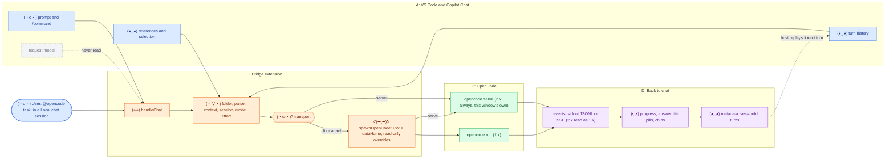

# (・∀・) 1. Big picture

[← index](README.md) · next: [One chat turn →](02-chat-turn.md)

## (´-ω-) Seven facts the picture hides

1. **No tool bridge.** Copilot tools are not sent to OpenCode, and OpenCode
   tools are not exposed to Copilot. gitScan is not one either: a standalone MCP
   server offered to Copilot, and to OpenCode only through a snippet you merge
   into `opencode.json`.
2. **The model comes from `model:` or settings**, not from Copilot's picker;
   so does the reasoning effort (`effort:` or the `effort` setting).
3. **History is not forwarded as messages.** It only recovers the OpenCode
   `sessionId`; OpenCode keeps the real conversation.
4. **Attachments become a text preamble.** Files go by path and OpenCode reads
   them from `cwd`. An open unsaved or ranged file, an untitled editor and
   `#problems` go as bounded text. What OpenCode will not get is said before the
   answer (`contextNotice`).
5. **Every OpenCode process goes through `spawnOpenCode()`** (`proc.ts`),
   including `serve`.
6. **Read-only is by permission, and checked.** Every spawn carries the
   overrides (`enforcedConfigContent`); before a read-only turn the effective
   rules are read back where it runs, and a reopened rule means nothing is sent
   (page 3).
7. **The front door is deprecated.** The Copilot harness has no chat
   participants, so `@opencode` answers in Local sessions only (page 8).
