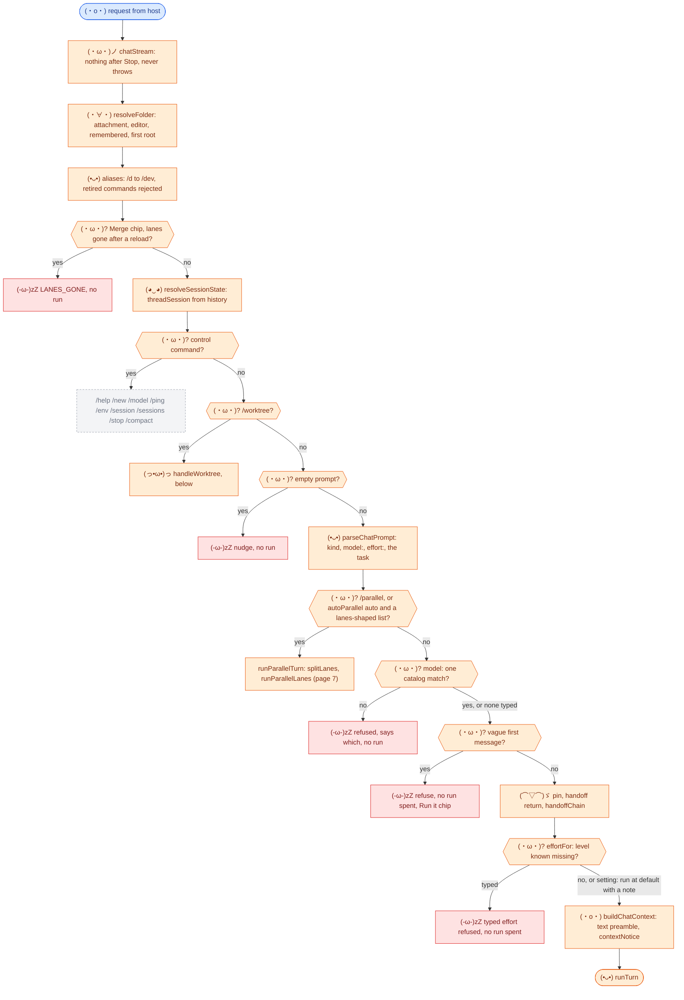
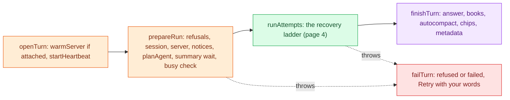
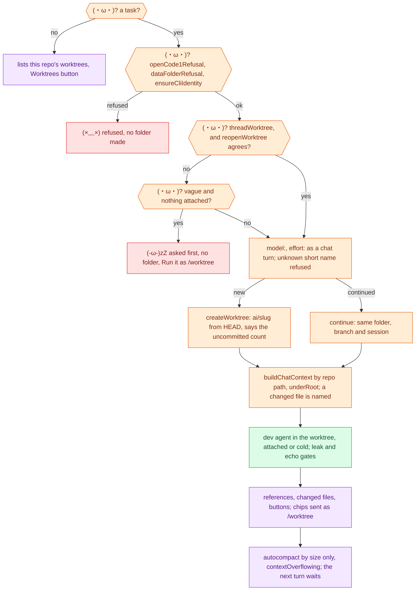
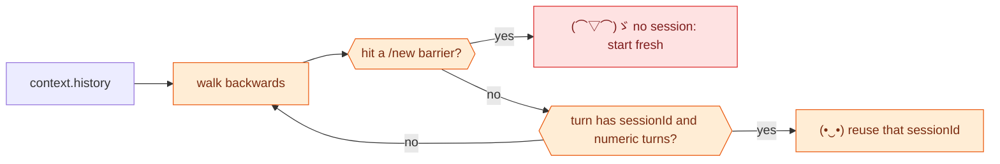

# (•ᴗ•) 2. One chat turn

[← big picture](01-big-picture.md) · [index](README.md) · next: [Transport →](03-transport.md)

The first diagram is `handleChat` (`src/chat.ts`), **before** OpenCode runs. The run itself, its recovery and the answer are `runTurn` (`src/chat-turn.ts`), `/parallel` is `runParallelTurn` (`src/chat-parallel.ts`), and `/worktree` is `handleWorktree` (`src/chat-worktree.ts`).

## (•ᴗ•) `runTurn`, in four parts

`prepareRun` logs what it spent as `pre-run: server Nms · agent Nms · summary Nms · busy-check Nms`.
Stop before it ends returns `notSent`, so the chip resends your words, not Continue.

## The vague-prompt gate, exactly

It refuses only when **all** hold: setting `clarifyVaguePrompts` is on, it is
the **first** message of the thread (no session yet), there are **no**
references, selection or inline origin, the text is judged vague, and the user
has not insisted. The reply points to `/ping` and gives example tasks; a
"Run it" chip is the way through.

## (っ•ω•)っ `/worktree`

Routed before `parseChatPrompt`, so `handleWorktree` reads for itself what a chat
turn reads (`WT10`–`WT12`). Copilot keeps the command sticky, so every later
message in that chat arrives as `/worktree`.

The metadata names the worktree, its base and `worktreeSession`, never `sessionId`
with `turns`, which bind the chat's own session. A continued session OpenCode no
longer has is replaced once, in the same worktree. `/session` and `/compact` reach
it through `threadWorktree`.

## (◕‿◕) Thread to session binding

Anything that re-binds a chat (`/sessions` Continue, Fork) must return that
metadata, because metadata is the only binding.

## What the host gives that is dropped

| Dropped | Why |
| --- | --- |
| `request.model` | Never read; the model is OpenCode's |
| Copilot tools | No `languageModelTools` contribution |
| History as messages | Only used to find the sessionId |
| Images, binary attachments, anything not a file on disk | Not sent, and the chat says so (`contextNotice`) |
| An unsaved file when no excerpt fits; `.env` text on a read-only turn | Path only or withheld, and said |
| VS Code's current-file chip | Implicit: said once per window. `#file` or `includeEditorSelection` sends it |
| Copilot's customizations index and instruction files | Logged only: OpenCode loads its own |

Output › OpenCode logs every reference the host sent, kept or dropped and why
(`referenceLogLine`).
