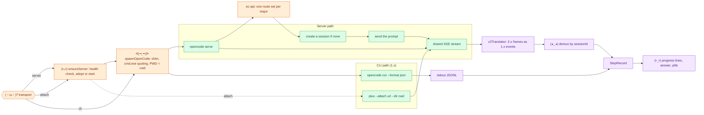
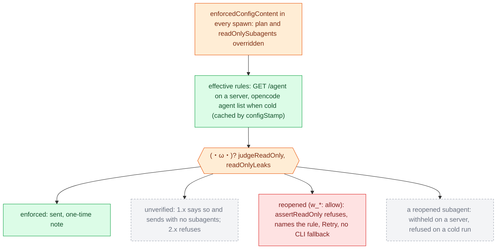
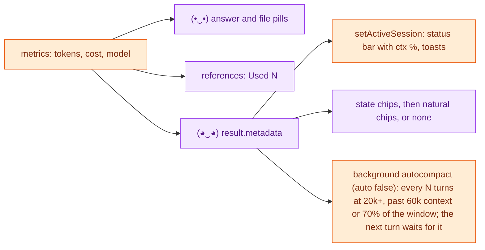

# ᕙ(⇀‸↼)ᕗ 3. Transport: how the request leaves and the answer returns

[← one chat turn](02-chat-turn.md) · [index](README.md) · next: [Recovery →](04-recovery.md)

## Choosing a transport

```
useServer = transport == "server" || (transport == "auto" && !isBuild)
attachDev = transport == "auto" && setting attachDevToServer (default true)
OpenCode 2: every turn goes through this window's server, whatever the two say
```

| Turn | Transport | Why |
| --- | --- | --- |
| Read-only (plan, look) with `auto` | server | Warm server avoids 48 to 69 s cold boots |
| `/dev` (build) with `auto` | CLI attached to the warm server | `--auto` exists only on the CLI |
| `/worktree` with `auto` | CLI attached, session rooted in the worktree; cold if that fails | As `/dev` |
| `/parallel` lanes with `auto` or `server` | attached to the warm server, one fresh session per lane | Cold runs serialise on one `opencode.db` |
| `transport: cli` | cold CLI | Explicit |
| `transport: server` | server | Explicit |
| Any turn on 2.x | server (`runOpenCode` hands over when `executableMajor` says 2) | Its `run` takes none of these flags, and a cold run's rules cannot be read back |



## Prewarm

`onStartupFinished` activates the extension, and `PREWARM_DELAY_MS` (3 s) later
`prewarmFolder` runs: trusted workspace, `prewarmServer` on. It starts or adopts
the server (`prewarmServer`), then reads the folder's agent list (`listAgents`).
That read is not idle: on 2.x a folder's MCP servers start with its first request
and their tools reach a turn 0.5–1 s later, and below 2.2.0 it settles the staged
agent list off the turn path. A first turn mid-boot joins the same start and is
told it waits. `transport: cli` starts no server; it only runs one `--version`.

## (•‿•) The read-only check

A read-only turn is judged on rules read back from where it runs, not on what was
injected. A reopened rule stops the turn. One path still runs unverified: a 1.x
server you started yourself keeps its agents' own rules, so `plan`'s shell is
limited by instruction only there, and each such turn says so. `serverPort: 0` or
the README's `look` agent closes it. 2.x refuses instead.



`/parallel` checks each lane's agent the same way before any lane runs.
`enforceReadOnly: false` restores read-only by instruction. A custom `planAgent`
is reported, never refused. These are tool permissions, not an OS sandbox.

## Effort on the wire

| Path | How the variant goes |
| --- | --- |
| CLI and attached CLI | `opencode run --variant <level>` |
| Server, 1.x | `"variant": "<level>"` in the `POST /session/:id/message` body |
| Server, 2.x | `POST /api/session/:id/model`, inside `model`, before the prompt. With no model named, `unpinnedModel` picks the one the run would use |

Sent every turn when set; never sent when empty. See page 7.

## SSE rules that matter

- **One shared stream, demuxed by session id.** `message.updated` carries a
  message id, not a session id; `server.heartbeat` carries none. Only a run's
  own events prove it alive.
- **Text and reasoning stream as `message.part.delta`** (a part id, no part);
  the whole part follows once at its end and adds only what the deltas did
  not. An attached `/dev` run takes the deltas from this stream too: its CLI
  prints a part only when it ends.
- **Streamed text passes two gates:** `createLeakGate` (a context block said
  back) and `createEchoGate` (the prompt said back), `/worktree` included.
- **Every 1.x call carries `?directory=<cwd>`.** Without it the server uses its
  own cwd, which may be another window's checkout. 2.x scopes the same way with
  `location[directory]`.
- **Killing an attach client does not stop the run**, and a prompt to a busy
  session queues silently. So every stop aborts on the server, and every send
  checks busy first.
- **2.x's prompt is asynchronous.** It answers at once, so `sessionPrompt` waits
  on that run's own events: delivered, then idle. A failed run's idle ends it
  even undelivered (0.0.230: it hung until Stop).

## Headless sessions

Sessions the bridge creates deny `question`, `plan_enter` and `plan_exit`
(`HEADLESS_PERMISSION`), and the bridge answers every permission or question ask
of the session and its subagents itself, keyed by `readOnly`. Nobody can answer
OpenCode's prompts from a chat turn.

## (•‿•) Post-run



While a run goes the status bar follows it (`OpenCode · plan · 1m 20s`, at the
chat line's milestones).
