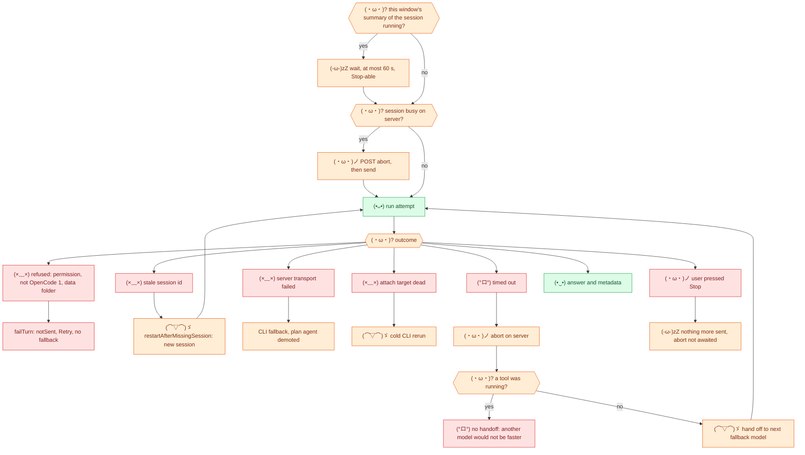

# (⌒▽⌒)ゞ 4. Recovery and Stop

[← transport](03-transport.md) · [index](README.md) · next: [APIs →](05-apis.md)

## Refused before sending

Not a failed run: nothing reached OpenCode. `failTurn` marks these `notSent`, the
chip is **Retry** with your words (with New session or Ping), and none falls back
to the CLI.

| Refusal | Test | Says |
| --- | --- | --- |
| Not OpenCode 1, `opencode2` off | `isNotOpenCode1` | Names the program and `opencode2` |
| `--version` could not confirm it | `isIdentityUnknown` | Timed out or printed no known version |
| Rules could not be set, read-only reopened, or a 2.x plan unverified | `isTurnPermissionError` | Names the rule or server |
| A 1.x on a data folder OpenCode 2 created | `isDataFolderClash` | Names `dataHome`; remembered until `/ping` or a new `dataHome` |

Also before anything runs, with no error: `model:` with no single match, a typed
`effort:` the model lacks, a vague first message, a Merge chip after a reload.

## The recovery ladder

| Step | Trigger | Result |
| --- | --- | --- |
| Summary running | `compactionInFlight` | Waits up to `SUMMARY_WAIT_MS`, then the busy policy stops it and says so; the session keeps its full context |
| Busy | `sessionBusy`, `busySessionPolicy: abort` | Unwatched run aborted first and said; `queue` waits behind it |
| Stale session | `isMissingSessionError` (server) or `isMissingSessionRun` (CLI exit) | New session, answer reset, once per turn |
| Server failed | Thrown error on server transport | CLI takes this and later attempts. If the agent was confirmed by the server only, it runs as the built-in `plan`, with a visible warning |
| Attach dead | `isAttachFailure` | Same attempt rerun cold |
| Timeout | `timeoutMs` or `idleTimeoutMs` elapsed; a tool gets `toolQuietMs` | Server abort awaited, then maybe handoff |
| Handoff | Model stall only | Next model in the chain, same session; after an unpinned handoff the next turn sends the earlier model once |
| Provider retry | `session.status` retry (2.x `session.retry.scheduled`) | Named on the live line, nothing to do |
| Stop | Cancellation token | Server abort **not** awaited |

On 2.x there is no CLI to fall back to: `runOpenCode` hands the turn back to the
server runner, so "CLI fallback" is one more try through the server. A `/worktree` turn has a smaller
ladder: a dead attach goes cold before the run starts, and a stale session is
replaced once.

## Chips that fit the failure

| What happened | Chips |
| --- | --- |
| Refused before sending (`notSent`) | Retry with your words, New session |
| Stop before anything was sent (`notSent`) | Retry with your words |
| Server unreachable | Retry, Ping |
| Rate limit, quota, overload, refused key, unknown model | Retry, Pick model |
| Stopped on a hung tool (`stuckTool`) | Skip it, Continue |
| Last step finished `length` | Finish it, first and never held |
| A subagent stopped (`failedTask`) | Resume with its id, else Rerun; never held |

## (・ω・)ノ Stop, precisely

- After Stop **nothing** arrives in the stream.
- About **1 s later the host stream throws**, so a turn must return within
  that second. This is why server aborts are fire-and-forget after Stop.
- Plain progress lines fade; task lines stay; a task open at Stop spins for
  good. So accordions are sent finished, and `stop()` waits `SETTLE_MS` after
  the last one.

## Test anchors (suite groups cited in AGENTS.md)

`HQ` headless asks · `LT4` `LT5` abort and busy checks · `LT7` liveness ·
`SP` stop · `PA` plan agent · `DM` handoff model · `GP` accordions ·
`RX` read-only refusal · `PM` `OC` `SE` refused before sending · `CQ` summary wait ·
`FX` chips that fit the failure · `TW` the 2.x path.
