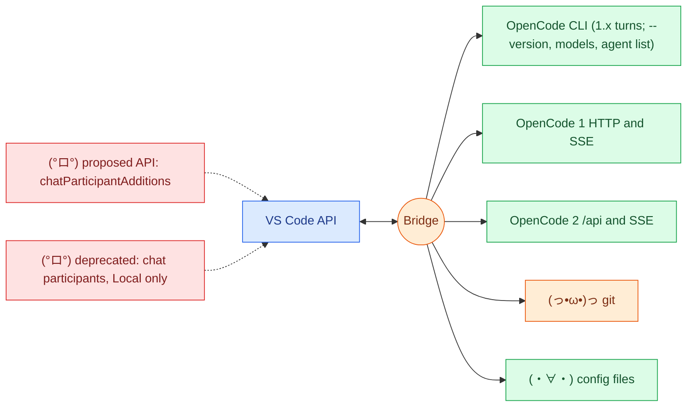

# ᕙ(⇀‸↼)ᕗ 5. APIs touched

[← recovery](04-recovery.md) · [index](README.md) · next: [Trust and trade-offs →](06-trust-and-tradeoffs.md)

## VS Code

| Area | APIs |
| --- | --- |
| Chat | `chat.createChatParticipant` (panel and inline, guarded: a host without it still activates), `followupProvider`, `onDidReceiveFeedback` |
| Response stream | `markdown`, `progress`, `anchor`, `reference`, `button`; task-progress overload feature-detected |
| Commands | `registerCommand`, `executeCommand("workbench.action.chat.open")` with `isPartialQuery: true`, `executeCommand("vscode.changes")` for the worktree diff, `workbench.action.openSettings` |
| Window | output channel, status bar, `showQuickPick`, `createQuickPick`, messages, `withProgress`, `showTextDocument` |
| Workspace | `getConfiguration` (ours, and the host's `chat.defaultToCopilotHarness` and `chat.editor.localAgent.enabled`, read only), folders, trust, `onDidChangeConfiguration`, `openTextDocument`, `registerTextDocumentContentProvider` for the read-only `ocb-base:` diff side |
| Env | `appName`, `remoteName`, `uiKind`, `clipboard`, `version` |
| State | `globalState`: chip backoff, the one-time read-only and Local notices |
| MCP (gitScan) | `lm.registerMcpServerDefinitionProvider`, `McpStdioServerDefinition`; its server copy via `workspace.fs` into `globalStorageUri`; `onDidGrantWorkspaceTrust` refreshes it |
| Proposed | `chatParticipantAdditions` (needs `--enable-proposed-api` or Insiders; only the inline participant needs it) |
| Activation | `onChatParticipant:*` and `onStartupFinished` (the prewarm, 3 s later); `deactivate()` kills the managed server |

## OpenCode CLI (always via `spawnOpenCode`)

| Command | Used for |
| --- | --- |
| `run [--attach url --dir cwd] [--agent] [--model] [--variant] [--session] [--pure] [--auto] [--format json] [--thinking]` | A 1.x turn |
| `serve --port --hostname` | Managed server, both majors |
| `agent list` | Which agents exist (`planAgent` is sent only once listed), and on a cold run each agent's merged rules (`readOnlyEvidence`, cached by `configStamp`) |
| `models [--verbose]` | Catalog fallback |
| `--version` | Which major? `/ping`, Diagnose, the `transport: cli` prewarm, and once before a window's first CLI run (`ensureCliIdentity`; again only when the file behind `executable` changes, `executableStamp`) — ~0.7 s on 1.19 |

Every spawn's environment adds `PWD` = cwd, `XDG_DATA_HOME` from `dataHome`
(`dataHomeEnv`), and `OPENCODE_CONFIG_CONTENT` with the read-only overrides in the
format that major reads: `agent.<name>.permission` on 1.x, `agents.<name>.permissions`
on 2.x. 1.x rejects the second key, and 2.x given both applied neither.

(°ロ°) `opencode run --agent <unknown>` silently runs `build` (exit 0). Always pass `--agent`.

(°ロ°) OpenCode 2 is also `opencode`: its health is a web page and its `run`
rejects `--attach --dir --variant --pure`. With `opencode2` off, seen once, that
executable runs nothing more in the window (`markNotOpenCode1`); with it on, no
`run` is used (page 8, REFS).

## OpenCode HTTP

Every call goes through `api(base)` in `oc-api.ts`, one route set per major; callers
speak 1.x's shapes. The stream is `connectSse` in `net.ts`.

### 1.x (every scoped call has `?directory=`)

| Method and path | Used for |
| --- | --- |
| `GET /global/health` | Is a server there, and is it OpenCode (`version`) |
| `GET /global/event` | Shared SSE stream |
| `POST /session` | Create, with headless permissions |
| `GET /session` and `GET /session?roots=true&limit=50` | `/ping` scope count; `/sessions` picker |
| `POST /session/:id/message` | Send a turn |
| `GET /session/:id/message?limit=` | Last messages |
| `GET /session/status` | Busy check |
| `POST /session/:id/abort` | Stop, timeout, busy |
| `POST /session/:id/summarize` | Autocompact, `/compact` (`auto: false`) |
| `POST /session/:id/fork`, `PATCH` and `DELETE /session/:id` | Fork, archive, delete, permission re-PATCH (a PATCH appends; the last match wins) |
| `GET /session/:id` | Whether a session from another window carries read-only `task` rules, before a `/dev` turn |
| `GET /session/:id/children` | The subagent sessions to abort with their parent |
| `GET /agent`, `GET /config/providers` | Agents with their effective rules (`readOnlyEvidence`; on a server this window did not start, which agents carry the overrides), model catalog |
| `POST /permission/:id/reply`, `POST /question/:id/reply` | Headless answers |
| `POST /session/:id/permissions/:permissionID` | The same answer for a pre-1.1 server (docs, not measured) |

SSE events consumed: `message.part.delta` (streamed text and reasoning),
`message.part.updated`, `message.updated`, `session.status` (provider retries),
`session.error`, `session.created`, `session.updated`, `permission.asked`,
`question.asked`;
`permission.updated` (pre-1.1) is answered like `permission.asked`, and
`permission.replied` confirms a reply (a 200 alone proves nothing, #15386).
`server.heartbeat` is ignored for liveness.

### 2.x (Basic auth with the password `serve` printed; `opencode2`, this window's server only)

| Method and path | Used for |
| --- | --- |
| `GET /api/info` | Health and version |
| `GET /api/event` | Shared SSE stream |
| `GET /api/agent?location[directory]=` | Agents with effective rules, read until settled below 2.2.0 (`AGENTS_SETTLE_MS`) |
| `GET /api/model?location[directory]=` | Model catalog |
| `GET /api/session?directory=&limit=&parentID=` | `/sessions`, `/ping`, a session's children (`roots` filtered here) |
| `GET /api/session/active` | Busy check (`running` read as `busy`) |
| `POST /api/session` | Create, with `location`, `permissions`, title in `metadata` |
| `GET`, `PATCH`, `DELETE /api/session/:id` | Read rules back, set rules or archive, delete. A metadata PATCH replaces the object, so it merges |
| `POST /api/session/:id/agent`, `POST /api/session/:id/model` | Agent, model and variant, set before each prompt |
| `POST /api/session/:id/prompt` | Queue a turn; answered at once with an inbox id |
| `GET /api/session/:id/message?limit=` | Last messages (newest first, reversed here) |
| `POST /api/session/:id/interrupt` | Stop, timeout, busy |
| `POST /api/session/:id/compact` | Autocompact, `/compact`; the result arrives as an event |
| `POST /api/session/:id/fork` | Fork |
| `POST /api/session/:id/permission/:askId/reply` | Headless answer. Questions are not answered: sessions deny the tool |

`v2Translator` (`v2-events.ts`) reads 2.x's frames as the 1.x events above, so
`run-steps`, `asks` and the demux are unchanged (`shell`→`bash`, `subagent`→`task`):
`session.step.*`, `session.tool.*`, `session.execution.*`, `session.retry.scheduled`,
`permission.asked`, `permission.replied`. Two it keeps for `oc-api` alone:
`session.inbox.delivered` (`v2.delivered`) and `session.compaction.*` (`v2.compaction`).

> Checked in source for this page: `oc-api.ts`, `v2-events.ts` and `connectSse`,
> read call by call on 0.0.236. Which of them a real server accepts is what the
> nightly probes and `scripts/fixtures/wire-v*.json` cover.

## (っ•ω•)っ git (only `src/worktree.ts` and `src/git-scan-server.ts`)

`execFile("git", argsArray)`, never through the `cmd.exe` path: `rev-parse`,
`worktree add|list|remove`, `branch -D`, `status --porcelain`, `add -N`, `diff`
(with `--stat` or `--name-status`), `show <sha>:<path>`, `merge-base`, `rev-list
--count`; and the gitScan server's one `status --porcelain=v2`, with filter drivers
blanked and submodules compared by commit only. The one thing written outside
OpenCode: `<repo>.worktrees/<slug>`, on command.

## (・∀・) Files read (read-only)

`opencode.json(c)`, global config, instruction files such as `AGENTS.md`, and
agent, plugin, MCP, command and skill listings, for `/env` and `/ping`; the config
files' stamps for the cold rule cache (`configStamp`); on a 2.x server, the 1.x
permission rules it would ignore (`v1PermissionRules`). Nothing is injected into
them.
