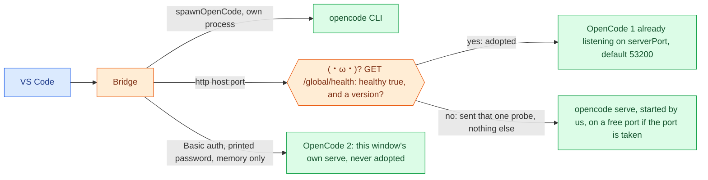

# (°ロ°) 6. Trust, pros and cons, next steps

[← APIs](05-apis.md) · [index](README.md) · next: [Lanes, chips, effort →](07-lanes-chips-effort.md)

## Trust boundaries

- (•‿•) **Adoption needs an identity (0.0.205).** `ensureServer` adopts a
  listener on the configured port only if `GET /global/health` answers
  `healthy: true` and names a `version`, as the real server does (the OpenCode
  docs list it). Anything else on that port is sent that one probe; this window
  starts its own server on a free port. A server this window started needs no
  version. Before the check, `scripts/probe-server-adoption.js` measured a fake
  listener receiving `POST /session` and `POST /session/<id>/message` with the
  prompt text in the body, and the workspace path in every `?directory=`.
  Since 0.0.201 the default port is `53200`, off OpenCode's common `4096`; `0`
  starts a private server on a free port and adopts nothing. Not measured:
  whether 1.18.27 to 1.18.33 send `version`.
- (•‿•) **Mitigation in place.** Untrusted workspaces cannot set `executable`,
  `dataHome`, `serverHostname`, `serverPort`, `enforceReadOnly` or `readOnlyTools`;
  the default host is `127.0.0.1`. The prewarm runs in trusted workspaces only.
- (•‿•) **Read-only is by permission and checked (0.0.215–0.0.219).** Effective
  rules are read back where the turn runs and judged by allowlist; a reopened rule
  stops the turn, and on 2.x so does an unverified one (page 3). The built-in
  `plan` is read-only by instruction only, on both majors, and `explore` has a
  shell, which is why the overrides exist.
- (°ロ°) **A 1.x server you started keeps its own rules.** Read-only turns there
  start no subagents and say they are unverified, but `plan`'s shell is limited by
  instruction only.
- (°ロ°) **`/dev` is not sandboxed.** It reads, writes and runs outside the folder
  on both majors (`known ·` rows in `scripts/probe-opencode2.js`). Permissions are
  tool permissions, not an OS boundary.
- **Session ids are untrusted:** URLs via `sessionPath`, argv via `safeSessionId`.
- **gitScan runs no repository-configured commands (0.0.220):** filter drivers
  blanked, submodules by commit only.

## (•‿•) Pros

| Strength | Evidence |
| --- | --- |
| Layered recovery | Stale session, server to CLI, attach to cold, busy abort, model handoff |
| One spawn point | `spawnOpenCode`; a suite tripwire counts `spawn(` sites |
| One request module | `oc-api.ts`: a new major is a new route set, not a check at each call site |
| Strong gate | `npm run ship`, 4 fail-fast checks; fake OpenCode binaries; `hostStream()` models the real host |
| CI | `ship.yml` on Linux, Windows, macOS; nightly `probes.yml` against real binaries; nightly `api-watch.yml` on the participant API |
| One version, one build | `docs/released.txt`: a delivered version whose code changed fails the gate |
| Isolation | One session per chat, `?directory=` on every call, headless sessions, nothing written to the workspace except `/worktree` |
| No runtime deps | Plain `tsc`, no bundler |
| Measured facts | `REFS.md` records what each OpenCode quirk cost |

## (×﹏×) Cons and risks

| Risk | Why it matters |
| --- | --- |
| Participant API deprecated | The biggest one. VS Code's Copilot harness has no participants, and from 1.142 it is progressively the default for new chats; the API stays for Local, with no removal date, and a managed policy can already disable Local. `@opencode` then cannot run at all (page 8). No `@deprecated` tag yet: `api-watch.yml` fails the day one appears |
| Undocumented OpenCode behaviour | Pinned to the measured ranges (`TESTED_OPENCODE`, `TESTED_OPENCODE2` in `net.ts`): `?directory=` semantics, message-vs-session ids, fork dropping permission rules, session rules that only append, attach kill not stopping the run. A server outside a range earns one line saying so; nothing negotiates, so an update can still break it |
| OpenCode 2 | Driven through its API since 0.0.222, but behind `opencode2`, off by default and experimental. One-way data folder: 1.x cannot open a folder 2.x created (`dataHome`). The probes on 2.2.5 use a scripted model: REFS has no real-model run on it |
| Proposed API | `chatParticipantAdditions` blocks Marketplace publishing and needs cast hacks that rot as the API stabilises; only inline chat depends on it, and on stable it needs the runtime flag |
| Windows weight | `proc.ts` is dominated by `cmd.exe` workarounds. The gate runs on Windows in CI, the nightly probes on Linux only. The first real-binary run on Windows was 0.0.236: 21 of 22, one control row (REFS) |
| Big modules | `runs.ts` (0.0.203), `chat-boot.ts` (0.0.204) and `handleChat` (0.0.205) were split; `net.ts`, `context.ts` and `chat-turn.ts` are the largest now (`wc -l src/*.ts`). The suite's `LY` checks the layering has no cycle |
| Heuristic streaming | `emitKeyedDelta` guesses ids when parts lack them; duplicate or lost text is possible |
| Metadata is the only binding | A lost blob silently starts a new session |
| Chat UI limits | No Thinking part or tool rows (proposed), no in-place progress, badges are inline-code pills |
| Bespoke tests | Not the VS Code test runner, no coverage metric, aborts on the first exception |

## (´-ω-) Suggestions, in order

Done, and kept for the record:

1. **Probe the adoption risk.** `scripts/probe-server-adoption.js`.
2. **Identity check before adoption.** 0.0.205: a version is required (suite `ID`).
3. **Version guard.** 0.0.204: a health `version` outside the tested range gets
   one line per window and version.
4. **Split `handleChat`.** 0.0.205: `chat.ts` routes and gates, `chat-turn.ts`
   opens, prepares, runs the recovery ladder and posts, `chat-parallel.ts` runs
   `/parallel`. (`runs.ts` was split in 0.0.203.)
5. **Keep these docs honest.** 0.0.212: the gate fails when a code name AGENTS.md
   or `docs/flow` cites in backticks is gone from the code.
6. **Drive OpenCode 2.** 0.0.221–0.0.223, through its HTTP API rather than ACP:
   ACP stays a probe (`scripts/probe-acp.js`), and no chat turn uses it.
7. **Say what the harness hides.** 0.0.231 and 0.0.235: Diagnose rows, a warning
   outside chat, activation that survives the API going.

Open:

8. **Decide the proposed-API stance:** sideloaded VSIX only, or wait.
9. **Turn `opencode2` on by default.** The first plan turn is fixed (0.0.233) and
   first-turn MCP tools too (0.0.234). Still to measure: a real model and macOS on
   2.2.5. Windows has its first probe run.
10. **Freeze the participant to bug fixes**, awaiting Jan's answer (CHANGELOG 0.0.235).
11. **Try a separate front end** before Local goes: an Agent Host Protocol host or
    language model tools. Neither has been run (REFS, *Agent Host Protocol*).

(°ロ°) Items 8 to 11 change code, the suite or the gate, so each needs a version
bump and a green `npm run ship`.
