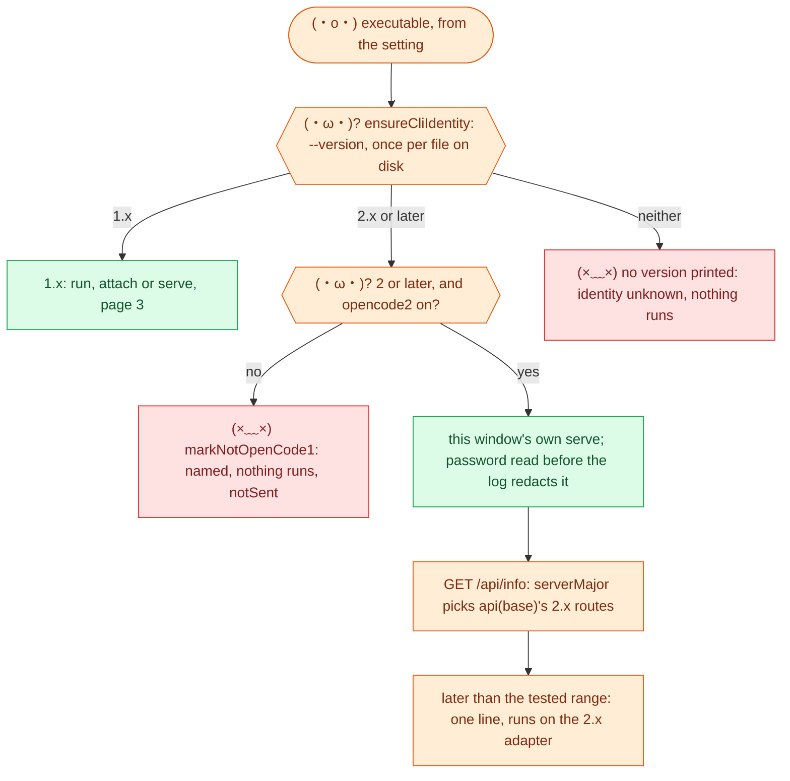
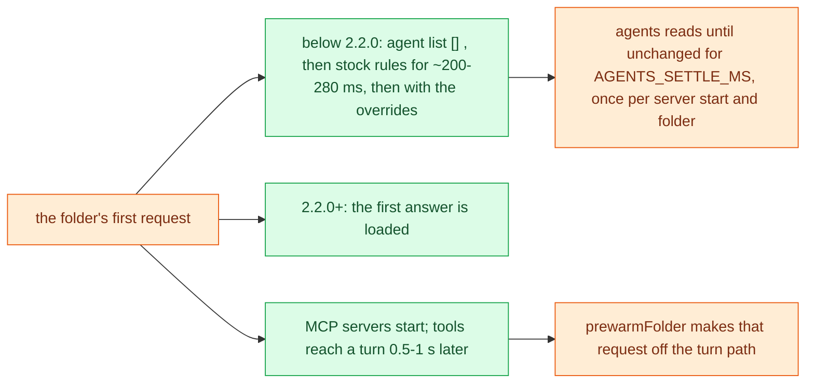
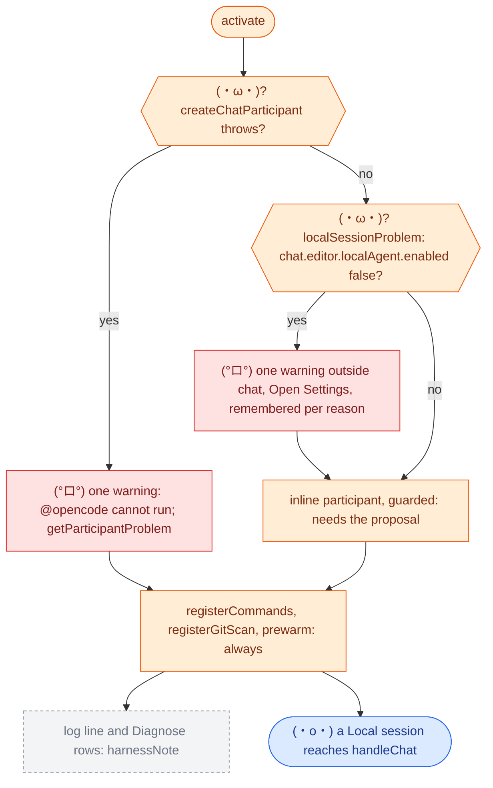

# (°ロ°) 8. OpenCode 2 and the Copilot harness

[← lanes, chips, effort](07-lanes-chips-effort.md) · [index](README.md)

Two moves outside this repo that the code has to survive: OpenCode's major version,
and VS Code's chat harness. Measurements are in REFS under the version named.

## Which major runs

`opencode2` is off by default (`openCode2Allowed`). A 2.x installed over a 1.x is
caught because the check is of the file, not the name (`executableStamp`). A server
answering health with a web page is the second way a 2.x is recognised.

## What differs on 2.x

| Topic | 1.x | 2.x with `opencode2` |
| --- | --- | --- |
| Turn | CLI, attached CLI, or server | Always this window's server |
| Server identity | Adopts a listener that names a `version` | Own server only; `/api/info` with the printed password |
| Prompt | Answered when the run ends | Queued, then awaited on the run's own events |
| Agent and model | In the message body | `POST` to the session before each prompt |
| Effort | `--variant`, or `variant` in the body | Inside the model `POST` only, so with no model named it is not sent (`sessionPrompt`, read in code on 0.0.236, not run) |
| Rule format | `{permission, pattern, action}`, `agent.<n>.permission` | `{action, resource, effect}`, `agents.<n>.permissions` (`toV2Rules`, `toV1Rules`) |
| Your own rules in `opencode.json` | Applied, and read back | Ignored without a word; `.opencode/agents/*.md` frontmatter is read. Named once per folder (`v1PermissionRules`) |
| Unverified plan turn | Warned, no subagents | Refused: 2.x's own `plan` writes |
| MCP on a read-only turn | `readOnlyTools`, as `<server>_<tool>` | 2.0, 2.1: none (Code Mode's `execute` holds them, denied). 2.2+: `readOnlyTools` by name, and no other |
| Close in `/sessions` | Archive | 2.1+: `archived: true`, read back. 2.0.x ignores it: the bridge's own mark in `metadata` |
| Questions | Denied, then answered | Denied; `questionReply` rejects |

## First turn on a fresh 2.x server

Both found in 0.0.232–0.0.234 by the probes, on real binaries:

Taking the first non-empty list judged `plan` unverified and refused the default
first turn: only ever the safe way. On Windows the first agent-list read took about
900 ms, so one control row of `scripts/probe-opencode2.js` reads differently there
(21 of 22, REFS, *0.0.236 on Windows*). Not a safety finding.

## The data folder runs one way

Both majors default to `~/.local/share/opencode`. 2.x adds its tables to a 1.x
`opencode.db`; 1.x cannot open one 2.x created (1.19.3: "Database is not empty and
has no session table") and exits on every spawn. `noteDataFolderClash` remembers it
per executable file, `dataFolderRefusal` refuses before spawning, until `/ping` or a
new `dataHome`. `dataHome` is `XDG_DATA_HOME` for every process the bridge starts
(`dataHomeEnv`); changing it stops the managed server and forgets the clash
(`forgetDataFolderClash`). See `docs/data-folder-design.md`.

## (◕‿◕) Where `@opencode` can answer

VS Code 1.142 started moving new chats to the Copilot harness, which has no chat
participants. The API is documented as deprecated, kept for Local sessions.

- **Why outside chat:** with Local hidden, Send stays disabled for `@opencode` and
  no turn of ours runs, so no reply could say it.
- **Not read:** managed sandbox or permission settings also disable Local;
  `localSessionProblem` looks only at the one setting.
- **The watch:** `api-watch.yml` runs `scripts/check-vscode-api.js` nightly. It fails
  when `vscode.d.ts` on main drops or marks `@deprecated` any of what the extension
  implements, then typechecks against the newest `@types/vscode`.

Suite groups: `TW` the 2.x path, `RX` `RE` read-only, `SE` the data folder, `OC`
identity, `PV` prewarm, `HR` the harness. Probes: `scripts/probe-opencode2.js`,
`scripts/probe-readonly.js`, both in `probes.yml`.
