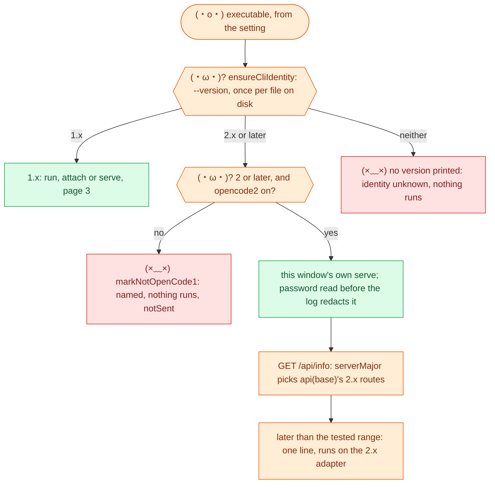
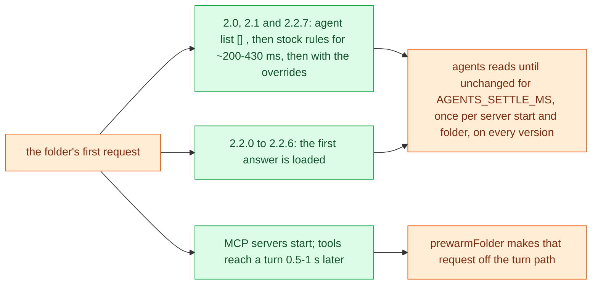
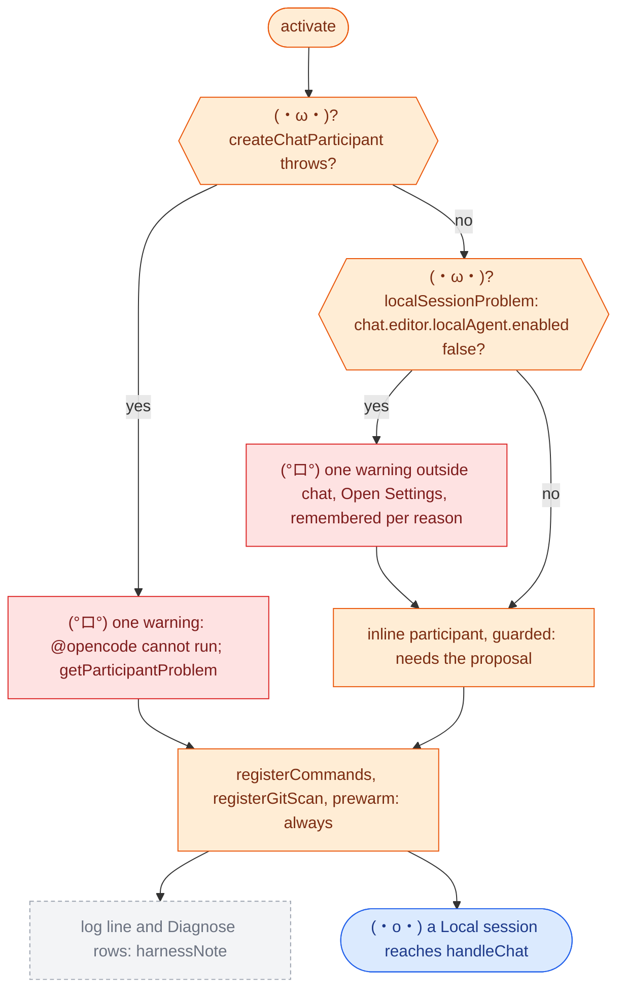
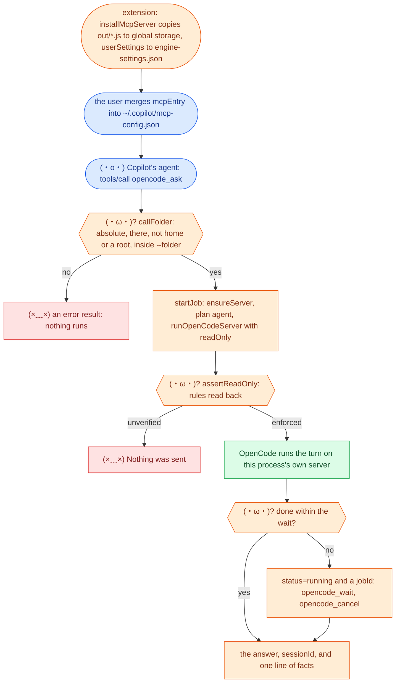

# (°ロ°) 8. OpenCode 2 and the Copilot harness

[← lanes, chips, effort](07-lanes-chips-effort.md) · [index](README.md)

Two moves outside this repo that the code has to survive: OpenCode's major version,
and VS Code's chat harness. Measurements are in REFS under the version named.

## Which major runs

`opencode2` is on by default (`openCode2Allowed`, 0.0.238), and `false` is the way out. A
2.x installed over a 1.x is
caught because the check is of the file, not the name (`executableStamp`). A server
answering health with a web page is the second way a 2.x is recognised.

## What differs on 2.x

| Topic | 1.x | 2.x with `opencode2` |
| --- | --- | --- |
| Turn | CLI, attached CLI, or server | Always this window's server |
| Server identity | Adopts a listener that names a `version` | Own server only; `/api/info` with the printed password |
| Prompt | Answered when the run ends | Queued, then awaited on the run's own events |
| Agent and model | In the message body | `POST` to the session before each prompt |
| Effort | `--variant`, or `variant` in the body; an unknown level is ignored; a prompt without one resets | Inside the model `POST` only; with no model named, on the session's, the agent's (from 2.1.4) or the default (`unpinnedModel`). An unknown level fails the run, so the catalog is read first; the session keeps the level, so a turn without one puts the default back |
| Rule format | `{permission, pattern, action}`, `agent.<n>.permission` | `{action, resource, effect}`, `agents.<n>.permissions` (`toV2Rules`, `toV1Rules`) |
| Your own rules in `opencode.json` | Applied, and read back | Applied (`bash` read as `shell`), and `.opencode/agents/*.md` frontmatter too; read back once the agent list settles (REFS 0.0.242) |
| Unverified plan turn | Warned, no subagents | Refused: 2.x's own `plan` writes |
| MCP on a read-only turn | `readOnlyTools`, as `<server>_<tool>` | 2.0, 2.1: none (Code Mode's `execute` holds them, denied). 2.2+: `readOnlyTools` by name, and no other |
| Close in `/sessions` | Archive | 2.1+: `archived: true`, read back. 2.0.x ignores it: the bridge's own mark in `metadata` |
| Questions | Denied, then answered | Denied; `questionReply` rejects |

## First turn on a fresh 2.x server

Found in 0.0.232–0.0.234 by the probes, on real binaries, and again in 0.0.239 when
2.2.7 went back to staging:

Taking the first non-empty list judged `plan` unverified and refused the default
first turn: only ever the safe way. No version is trusted to answer loaded any more
(0.0.233 read 2.2.0+ once; 2.2.7 broke that). The settled read also gives the MCP
servers their start, so a first turn has them with or without prewarm. On Windows the first agent-list read took about
900 ms, so one control row of `scripts/probe-opencode2.js` reads differently there
(21 of 22, REFS, *0.0.236 on Windows*). Not a safety finding.

## The data folder

Both majors default to `~/.local/share/opencode`. The first time 2.x opens a folder 1.x
used, it imports the sessions: a chat bound to one goes on in it. 1.x still opens the
folder and goes on in its own. From then on each sees only what it wrote
(`scripts/probe-data-folder.js`, real 1.19.5 with 2.0.29, 2.2.5 and 2.3.2; a large folder is not
measured). The closed case: 1.x cannot open a folder 2.x *created* (1.19.3: "Database is
not empty and has no session table") and exits on every spawn. `noteDataFolderClash` remembers it
per executable file, `dataFolderRefusal` refuses before spawning, until `/ping` or a
new `dataHome`. `dataHome` is `XDG_DATA_HOME` for every process the bridge starts
(`dataHomeEnv`); changing it stops the managed server and forgets the clash
(`forgetDataFolderClash`). See `docs/data-folder-design.md`.

## (◕‿◕) Where `@opencode` can answer

VS Code 1.142 started moving new chats to the Copilot harness, which has no chat
participants. The API is documented as deprecated, kept for Local sessions, and
the docs give Local an end: "will be removed in February 2027" (1.146 notes).

- **Why outside chat:** with Local hidden, Send stays disabled for `@opencode` and
  no turn of ours runs, so no reply could say it.
- **Not read:** managed sandbox or permission settings also disable Local;
  `localSessionProblem` looks only at the one setting.
- **The watch:** `api-watch.yml` runs `scripts/check-vscode-api.js` nightly. It fails
  when `vscode.d.ts` on main drops or marks `@deprecated` any of what the extension
  implements, then typechecks against the newest `@types/vscode`.

## (・o・) The way in without a participant: MCP tools (alpha)

The Copilot harness calls MCP tools, and reads the user's own `mcp-config.json` for
them. `oc-mcp-server.ts` is the engine as a stdio server in a process of its own:
no `vscode`, its settings from a file, its own `opencode serve`.

- **Handles, not connections:** `folder`, `sessionId` and `jobId` are tool arguments.
  MCP 2026-07-28 is stateless and deprecates roots; the server answers that revision
  and 2025-11-25's `initialize`.
- **`opencode_dev` is opt-in:** listed only when the entry's `args` has `--dev`.
- **Stop:** `notifications/cancelled` or `opencode_cancel` aborts the run in
  OpenCode; the job ends only once the session is idle and quiet, so the next
  prompt does not read the stopped run's end.
- **Closing:** stdin closed stops the runs and the server it started.
- **Not measured:** the Copilot harness itself. `docs/local-agent.md` task 2 runs it.

Suite groups: `TW` the 2.x path, `RX` `RE` read-only, `SE` the data folder, `OC`
identity, `PV` prewarm, `HR` the harness, `EN` the engine without VS Code, `MP` the
MCP server. Probes: `scripts/probe-opencode2.js`, `scripts/probe-readonly.js`,
`scripts/probe-mcp.js`, all in `probes.yml`.
